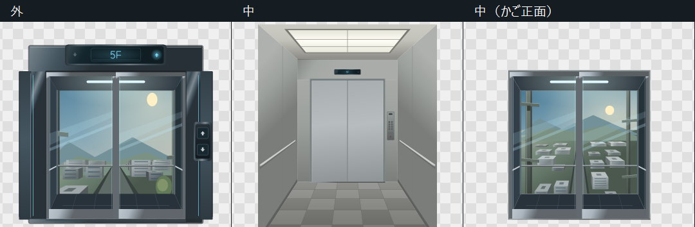

# エレベーター演出（SYNC_Elevator）

AviUtl2 のタイムラインで、エレベーターの呼び出し、乗車、昇降、降車を演出するメディアオブジェクトです。明治・大正風から近未来風までの7年代と、標準・展望・貨物用・工事用・鉱山用の5種類を選べます。扉、かご、階数表示、窓越しの風景、効果音を生成します。

## 導入と使い方

1. `SYNC_Elevator.zip` を展開し、中の `SYNC_Elevator` フォルダーを AviUtl2 のプラグインフォルダーに配置します。 [ダウンロード](https://github.com/vramwiz/SYNC_Elevator/releases/latest)
2. タイムラインにグループ「SYNC」の「エレベーター演出」を追加します。
3. 「プリセット設定」で場面・年代・種類を選び、「設定を反映」を押します。扉の構造、階数表示、色、背景などは個別に調整できます。
4. 「自分の階」「目的階」と「時間」を設定します。外側では「エレベーターの初期階」も指定します。タイムライン上で使う場面に合わせてオブジェクトの長さを調整します。

## 場面を選ぶ

| 場面 | 演出 |
| --- | --- |
| 外 | 乗り場からかごを見ます。かごが初期階から自分の階へ来て、扉を開閉したあと、目的階へ発進します。縦窓・格子・ガラス越しにかごの動きが見えます。ガラス越しの背景は乗り場の階に固定されます。 |
| 中 | かごの内側から自分の階を出発し、目的階で扉が開きます。展望タイプでは背面の広いガラスと左右の細いガラスから眺望を見せます。 |
| 中（かご正面） | かごと扉を正面から見ながら、自分の階から目的階へ移動する乗車中の演出を使えます。 |

「時間」は1回の移動にかかる秒数です。「外」では呼び寄せと閉扉後の移動にそれぞれ適用されます。地下階は負数で指定します。たとえば `-1` は B1 で、その上は 1F です。

内側の「開始時の扉」は初期状態で「閉じた状態」です。「全開から閉める」に切り替えると、乗り込んだあとの閉扉を見せられます。閉扉から発進までの間は「閉扉後待機時間」、到着から開扉までの間は「到着後待機時間」で調整できます。「到着後待機時間」は外側の乗り場でも使えます。

## 動作パターン

「時間設定」の「動作パターン」で、場面を変えずに演出の流れを選べます。初期値は「従来どおり」です。「設定を反映」で場面・年代・種類を変えても、動作パターンは引き継がれます。

| 動作パターン | 演出 |
| --- | --- |
| 従来どおり | 移動して扉を開け、開放時間が過ぎたら閉めます。「外」では閉扉後に目的階へ向かいます。 |
| 到着して開く | 到着後待機を経て扉を開け、オブジェクトの終端まで全開を保ちます。 |
| 閉じて出発 | 全開で始まり、開始待機のあと扉を閉めて、自分の階から目的階へ向かいます。着いたあとも扉は全閉です。 |
| 移動のみ | 扉を閉じたまま移動し、効果音は駆動音だけが鳴ります。 |
| 開閉のみ | 自分の階に停車したまま、開始待機のあと扉を開け、開放時間が過ぎたら閉めます。 |

「到着して開く」と「移動のみ」は、「外」では初期階から自分の階へ、「中」と「中（かご正面）」では自分の階から目的階へ移動します。内側の「開始時の扉」は「従来どおり」に適用されます。「閉扉後待機時間」は内側の「従来どおり」「到着して開く」「閉じて出発」に適用されます。

## 窓と背景

- 昭和風の一部の扉には縦窓が付きます。「扉の縦窓」で表示を切り替え、「縦窓の透明度」で見え方を調整できます。0が不透明、100が透明です。
- 車内で見える生成背景は階の高さに合わせて動きます。低層では近くの建物が窓を通り、高い階では屋根や道路を見下ろします。地下では暗い昇降路の梁とレールが流れます。「背景なし」を選ぶと、透過部分から下のレイヤーが見えます。
- 内側で自作のフロア画像を使うには、「奥のフロア画像を使う」をオンにし、出発階と到着階の画像を下のレイヤーに置きます。発進直後に出発階が窓から流れ、到着直前に到着階が窓に入ってきます。切り替えは片側最大0.5秒です。到着階の画像は切り替えが始まるまでに表示しておきます。

## 立ち絵と効果音

立ち絵をかごや扉の間に入れるには、同じ開始フレームでオブジェクトを複製し、一方で「奥側の構造物」、もう一方で「手前側の構造物」を表示して、その間に立ち絵を置きます。複製した片方の「音声出力」をオフにすると、効果音の重複を防げます。

ボタン、駆動、到着、扉開閉の効果音は「音量」と「音声出力」で調整できます。位置と大きさは AviUtl2 の標準描画で合わせます。

## ライセンス

GPL-3.0-only で配布します。 [ライセンス](LICENSE) · [ライブラリと共通基盤の出典](THIRD_PARTY_NOTICES.md)
